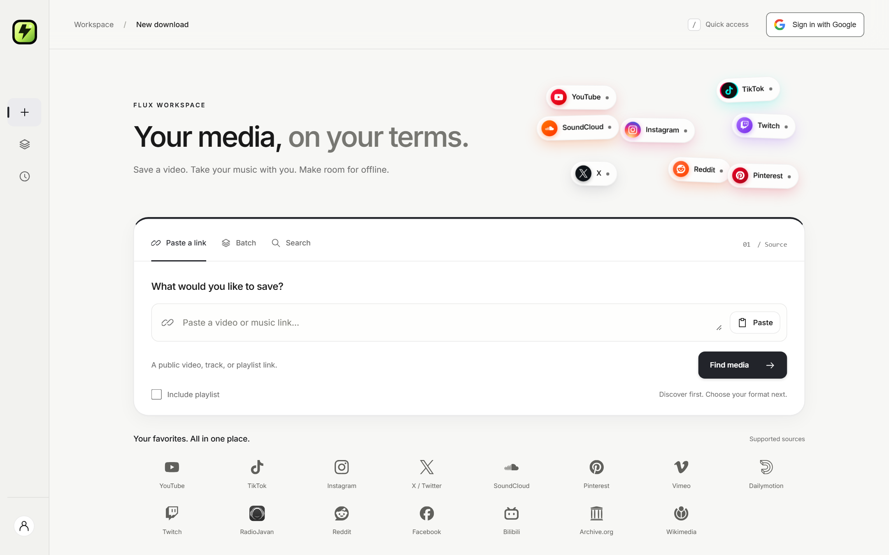
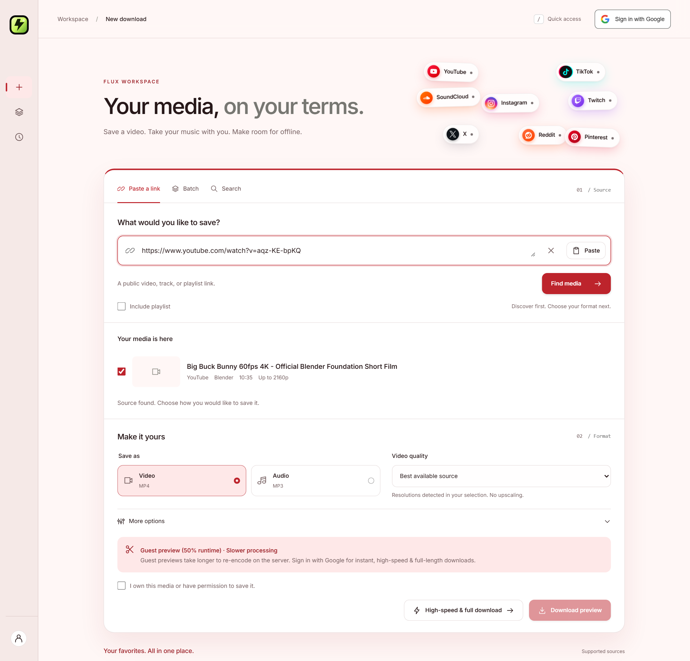
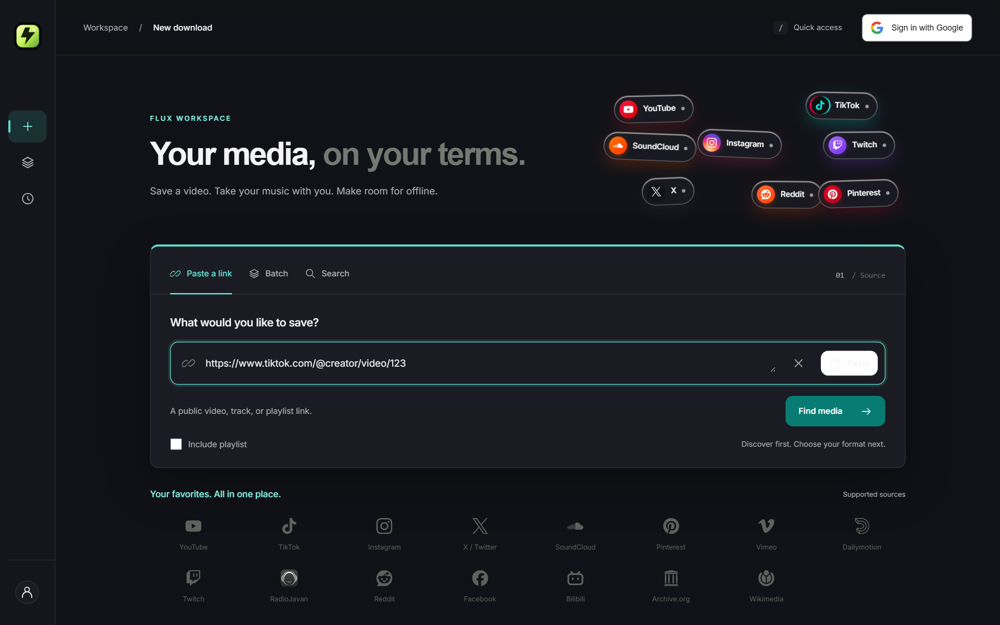
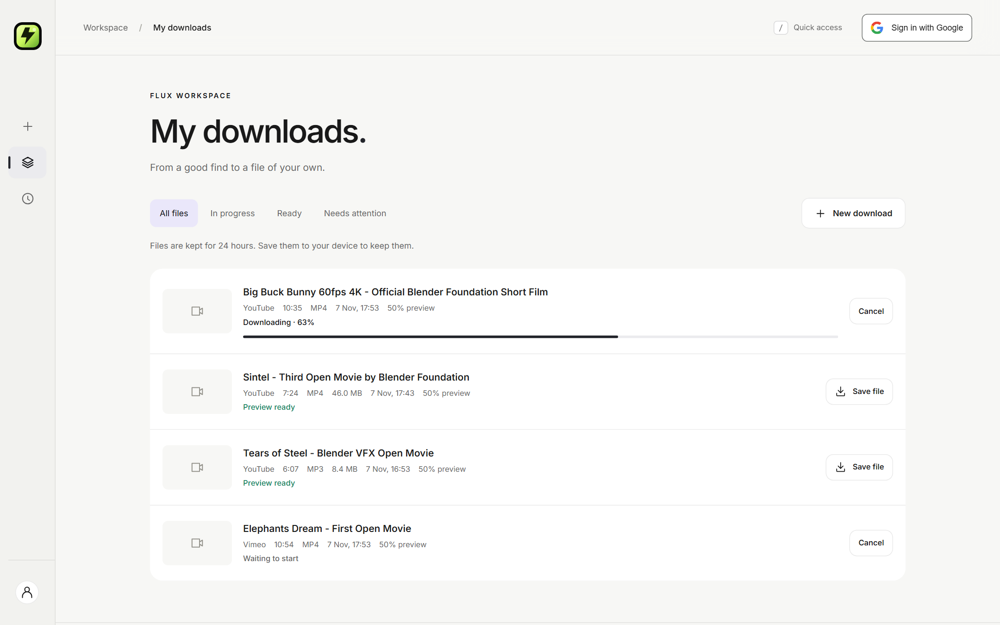
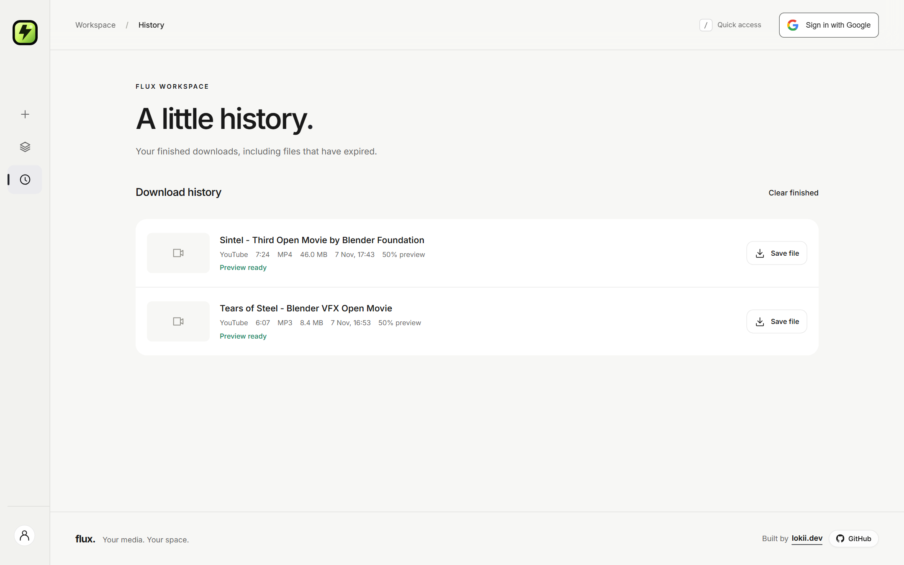
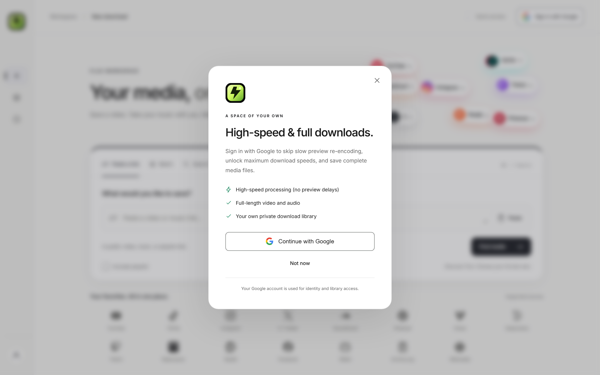
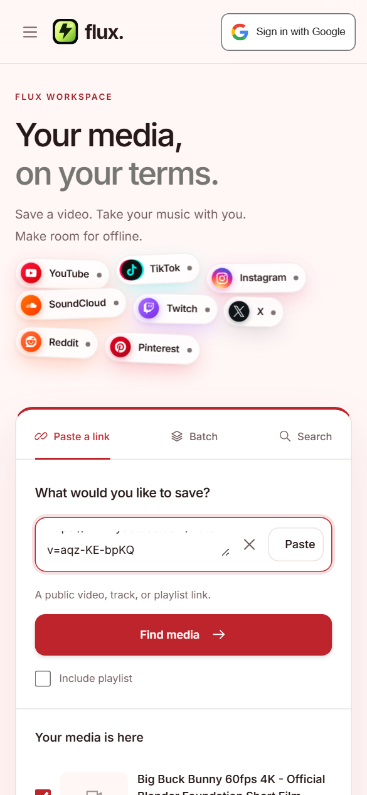
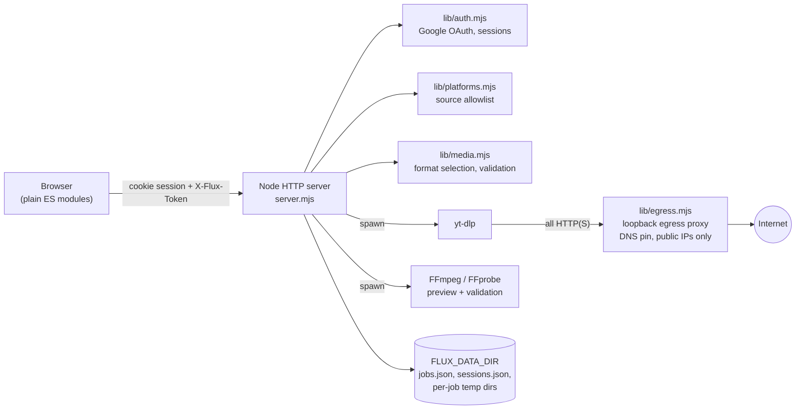

<div align="center">


# flux.

**Your media. Your space.**

A fast, private, self-hostable media workspace. Paste a link, pick a format, save it offline.
Built with plain HTML, CSS and ES modules on the front end, and Node.js, yt-dlp and FFmpeg on the back end.
**No frontend build step. Two runtime dependencies.**

> **Want to contribute?** Pick a [good first issue](https://github.com/10k11/flux/labels/good%20first%20issue), say hi in [Discussions](https://github.com/10k11/flux/discussions), and open a PR. Setup takes about a minute: `npm ci && npm run setup && npm run dev`.

[](https://github.com/10k11/flux/actions/workflows/ci.yml)
[](LICENSE)


[](CONTRIBUTING.md)
[](https://github.com/10k11/flux/labels/good%20first%20issue)
[](AGENTS.md)

[Features](#-features) ·
[Screenshots](#-screenshots) ·
[Quick start](#-quick-start) ·
[Configuration](#-configuration) ·
[Architecture](#-architecture) ·
[Security](#-security-model) ·
[Deploy](#-deployment) ·
[Contributing](#-contributing)



</div>

---

## ✨ Features

### Download workflow

- **Three ways to find media**: paste a single link, paste a **batch** of links, or **search** by keyword.
- **Metadata first, download second.** Flux resolves the real title, creator, duration and available resolutions *before* you commit to anything.
- **Video (MP4) or audio (MP3)**, with a resolution cap (only resolutions the source really offers, no fake upscaling) and MP3 bitrates of 128/192/256/320 kbps.
- **Subtitle embedding** and language selection where the source provides them.
- **Playlists** become individual jobs, each validated separately.
- **Live queue** with real progress. When total bytes are unknown the progress is `null`. Flux never invents a percentage.
- **Cancel, retry, regenerate and clear** actions, all scoped to the owner.
- **Resumable downloads** through HTTP range requests on the file endpoint.
- **Automatic cleanup**: finished files expire after a configurable retention window (24 h by default), while history records stay and offer one-click regeneration.

### Guests vs. signed-in users

| | Guest | Signed in with Google |
| --- | :---: | :---: |
| Inspect and search links | ✅ | ✅ |
| Download **genuine 50% previews** | ✅ | ✅ |
| Full-length downloads | ❌ (`401` at the API) | ✅ |
| Private download library | per-browser | per account |
| Guest records carry over on sign-in | n/a | ✅ |

### Genuine previews, not trimmed fakes

Guest previews are produced by FFmpeg on the server. Flux probes the real duration of the downloaded source, re-encodes from the beginning to exactly half of the *measured* runtime, runs FFprobe on the output, and fully decodes it to catch corruption. Only a validated file is ever offered for download, and the full-length source is deleted straight after.

### Source-aware interface

Paste a link and the whole workspace re-themes to match the platform (surface, type, controls and colour tokens) with a single bottom-up colour sweep. TikTok and X get a dark treatment, the rest get distinct light ones. Mixed batches and unknown URLs keep the Flux default, and the sweep is disabled for users who prefer reduced motion.

### 15 supported source families

YouTube · TikTok · Instagram · X / Twitter · SoundCloud · Pinterest · Vimeo · Dailymotion · Twitch · RadioJavan · Reddit · Facebook · Bilibili · Archive.org · Wikimedia

> These are *conditional source families* powered by yt-dlp extractors, not individually guaranteed integrations. Platforms change often. Operators can add reviewed hosts with `FLUX_EXTRA_SOURCE_HOSTS`.

### Craft and accessibility

- Semantic HTML, responsive from **1440 px down to 320 px**, an auto-collapsing desktop rail and a mobile drawer.
- Keyboard-first: skip link, a `/` quick-access shortcut, managed dialog focus and full tab order.
- **Automated axe-core WCAG A/AA checks** on every page and the auth dialog at 1440, 390 and 320 px.
- Respects `prefers-reduced-motion`.

---

## 📸 Screenshots

<table>
  <tr>
    <td width="50%"><br /><sub><b>Lookup → choose.</b> Real metadata, detected resolutions, MP4/MP3.</sub></td>
    <td width="50%"><br /><sub><b>Source-aware theming.</b> Paste a TikTok link and the workspace goes dark.</sub></td>
  </tr>
  <tr>
    <td width="50%"><br /><sub><b>My downloads.</b> Live progress, queue state and one-click saves.</sub></td>
    <td width="50%"><br /><sub><b>History.</b> Expired files keep their record and can be regenerated.</sub></td>
  </tr>
  <tr>
    <td width="50%"><br /><sub><b>Google sign-in.</b> Server-side OAuth with PKCE, identity only.</sub></td>
    <td width="50%" align="center"><br /><sub><b>Mobile.</b> Fully responsive down to 320 px.</sub></td>
  </tr>
</table>

<sub>Screenshots are generated from fixture data with `node scripts/screenshots.mjs`, so they never show real user content.</sub>

---

## 🚀 Quick start

**Requirements:** Node.js **22.9+** (24 LTS recommended). `npm run setup` downloads yt-dlp for you (checksum-verified) and, on Windows x64, FFmpeg/FFprobe too. On macOS/Linux install FFmpeg with your package manager (`brew install ffmpeg`, `apt install ffmpeg`).

```sh
git clone https://github.com/10k11/flux.git
cd flux
npm ci
npm run setup     # fetches yt-dlp (and FFmpeg on Windows) into ./bin
npm start
```

Open **http://localhost:3000**. Guest previews work immediately, with no Google credentials needed.

```sh
cp .env.example .env   # optional: tune limits, enable Google sign-in
npm run dev            # auto-restarting dev server
```

### Docker (with automatic HTTPS)

```sh
cp .env.example .env   # set FLUX_PUBLIC_HOST=your.domain
docker compose up -d --build
```

This starts Flux, an internal PO-token provider for YouTube, and Caddy, which terminates TLS and obtains certificates automatically. See [Deployment](#-deployment).

---

## ⚙️ Configuration

All configuration is through environment variables (loaded from `.env` by `npm start`).

| Variable | Default | Purpose |
| --- | --- | --- |
| `FLUX_ORIGIN` | `http://localhost:3000` | Canonical public origin. **HTTPS required** outside localhost. No trailing slash. |
| `GOOGLE_CLIENT_ID` / `GOOGLE_CLIENT_SECRET` | none | Enables Google sign-in. Server-side only. |
| `FLUX_PUBLIC_HOST` | none | Domain used by Docker Compose and Caddy. |
| `FLUX_PUBLIC_OPEN` | `0` | `1` = open to the internet (rate limits apply). |
| `FLUX_ACCESS_PASSWORD` / `FLUX_ACCESS_USERNAME` | none / `flux` | Optional HTTP Basic gate for private deployments. |
| `FLUX_MAX_CONCURRENT` | `2` | Simultaneous jobs on the whole server. |
| `FLUX_MAX_FILESIZE` | `4G` | Largest single file fetched. |
| `FLUX_MAX_DURATION` | `7200` | Maximum source duration in seconds. |
| `FLUX_MAX_JOB_BYTES` | `4294967296` | Aggregate temp bytes per running job. |
| `FLUX_RETENTION_HOURS` | `24` | How long finished files are kept. |
| `FLUX_INSPECT_PER_10MIN` | `40` | Link lookups per visitor per 10 minutes. |
| `FLUX_JOBS_PER_HOUR` | `15` | Jobs started per visitor per hour. |
| `FLUX_ACTIVE_PER_VISITOR` | `6` | Queued + running jobs per visitor. |
| `FLUX_TRUST_PROXY` | `0` | Trust `X-Forwarded-For`. Enable **only** behind a proxy that overwrites it. |
| `FLUX_EXTRA_SOURCE_HOSTS` | none | Extra reviewed source hostnames (comma-separated). |
| `FLUX_DATA_DIR` | `./data` | Private state: jobs, sessions, temp media. |
| `YTDLP_PATH`, `FFMPEG_PATH` | auto | Override tool locations. |

<details>
<summary><b>Setting up Google sign-in</b></summary>

Flux uses Google's server-side OAuth **authorization-code flow** with the official `google-auth-library`. No Supabase or separate auth service is needed.

1. In Google Cloud → Google Auth Platform, configure the consent screen (name, support email, audience; add test users while in testing).
2. Create an OAuth client of type **Web application**.
3. Register the exact redirect URI:
   - Local: `http://localhost:3000/auth/google/callback`
   - Production: `https://YOUR_DOMAIN/auth/google/callback`
4. Set the server-only variables:

   ```dotenv
   FLUX_ORIGIN=https://YOUR_DOMAIN
   GOOGLE_CLIENT_ID=your-web-client-id
   GOOGLE_CLIENT_SECRET=your-client-secret
   ```

5. Restart Flux, then sign in, refresh, sign out and test cancellation.

Use **one canonical hostname**: `localhost` and `127.0.0.1` do not share cookies. Without credentials the sign-in dialog says so honestly and shows no fake button.

</details>

---

## 🏗 Architecture



**The download pipeline:**

`Source input → URL validation → metadata → selection → verified session → owned job → extraction → preview / full processing → private file delivery → history`

### Project layout

```text
flux/
├── server.mjs            HTTP server, routing, job queue, rate limits
├── lib/
│   ├── auth.mjs          Google OAuth (PKCE, state, nonce), sessions, CSRF
│   ├── egress.mjs        SSRF-safe loopback proxy for extractor traffic
│   ├── media.mjs         yt-dlp argument builder, format rules, validation
│   └── platforms.mjs     Supported source families
├── public/               Static front end (no bundler)
│   ├── index.html · styles.css · app.js · api.js · components.js · icons.js
├── scripts/              setup, syntax check, screenshots, icon generation
├── test/                 node:test unit/integration + Playwright + axe suites
├── docs/screenshots/     README images
├── Dockerfile · compose.yaml · Caddyfile
└── .github/              CI, issue forms, PR template, Dependabot
```

**Design decisions:**

- **Zero build step.** `public/` is served as-is. Edit, refresh, done.
- **Two runtime dependencies**: `google-auth-library` and `ipaddr.js`. Everything else is the Node standard library.
- **Single process, single volume.** JSON state with atomic replacement keeps self-hosting trivial. Don't run multiple instances on one data directory; move to a database and shared queue before scaling horizontally.

### API

All `POST` endpoints require the session's `X-Flux-Token` CSRF header.

| Endpoint | Purpose |
| --- | --- |
| `GET /api/session` | Guest/account session, CSRF token, Google config status, retention |
| `GET /auth/google` · `/auth/google/callback` | Start / complete OAuth |
| `POST /api/logout` | Revoke session, issue a fresh guest session |
| `POST /api/inspect` | `{url, playlist?}` or `{search}` → real metadata/results |
| `POST /api/jobs` | `{items:[{url}], mode:"preview"\|"full", authorized:true, options}` |
| `GET /api/jobs` | The current owner's jobs only |
| `POST /api/jobs/:id/cancel` · `/retry` | Cancel an active job / regenerate a failed or expired one |
| `GET /api/jobs/:id/files/:index` | Private, cookie-authenticated file stream (range-enabled) |
| `POST /api/jobs/clear` | Remove the owner's finished records and files |
| `GET /api/health` | Actual yt-dlp / FFmpeg availability |
| `GET /api/platforms` | Source-family directory |

`options`: `format` (`mp4`/`mp3`), `quality` (best or a resolution cap), `bitrate` (128/192/256/320), `subtitles`, `language`.
Job states: `queued`, `processing`, `downloading`, `completed`, `failed`, `cancelled`, `expired`.

---

## 🔒 Security model

Flux is designed to be exposed to the internet, so security is a core feature, not an afterthought.

- **Server-side OAuth** with state + PKCE + nonce. The ID token's signature, audience, issuer, expiry and `email_verified` are all checked. Only `openid email profile` are requested, and Google access/refresh tokens are **never stored**.
- **Sessions**: opaque tokens stored **hashed**, `HttpOnly`, `SameSite=Lax`, `Secure` over HTTPS, rotated on login/logout, 7-day expiry, per-session CSRF tokens.
- **Authorization on every object**: jobs, lists, retries, cancels, clears and file delivery are checked against the session owner. Full downloads require a verified account. Browser-supplied identity fields are ignored.
- **SSRF protection**: extractor traffic goes through a loopback-only egress proxy that validates DNS results and **pins a public IP per connection**, including redirects. Private, loopback, link-local, reserved and IPv4-mapped addresses are refused.
- **Argument-injection safe**: URLs are passed as separate `spawn` arguments after `--`. No credentials or custom ports in source URLs, and no arbitrary extractor arguments are accepted.
- **FFmpeg sandboxing**: preview processing is limited to local `file`, `data` and `crypto` protocols.
- **Resource limits**: duration, per-job bytes, file size, concurrency, per-visitor and per-IP rate limits, and an aggregate disk guard.
- **No public file serving**: media is only reachable through authenticated streams, never held fully in memory.

Found a vulnerability? Please follow [SECURITY.md](SECURITY.md) and **do not** open a public issue.

---

## 🌐 Deployment

```sh
cp .env.example .env
# set FLUX_PUBLIC_HOST, GOOGLE_CLIENT_ID/SECRET, and FLUX_PUBLIC_OPEN=1 (or a password)
docker compose up -d --build
```

1. Point your domain's **A/AAAA record** at the server (ports 80 and 443 open).
2. Caddy obtains and renews TLS certificates automatically.
3. Register `https://YOUR_DOMAIN/auth/google/callback` in Google Cloud.
4. The **PO-token provider** (`flux-pot`) stays on the internal Docker network. **Never publish its port.**

> **Operator notes.** YouTube may still block datacentre IPs or require extra checks, and a token provider is no guarantee. Keep yt-dlp and FFmpeg updated (rebuild the image regularly), apply container filesystem quotas, and add outbound firewall rules as defence in depth. The optional cookies file is sensitive and must never be served. The shared Basic-auth password is only an outer gate and does **not** grant full-download privileges.

---

## 🧪 Development & testing

```sh
npm run check          # parse every module
npm test               # unit + integration (incl. real FFmpeg tests)
npm run format:check   # Prettier

# with the server running:
npx playwright install chromium
npm run test:browser   # end-to-end workflow, responsive checks
npm run test:a11y      # axe-core WCAG A/AA
node scripts/screenshots.mjs   # regenerate README screenshots
```

What the suite covers: URL validation, format selection, session rotation/persistence/revocation, OAuth state/nonce verification, CSRF, guest-full denial, cross-owner isolation, blocked internal destinations, real FFmpeg preview generation (a 600 s video → ~300 s, a 240 s audio → ~120 s, fully decoded), 18 responsive page checks and axe scans.

---

## 🗺 Roadmap

Ideas welcome via [issues](https://github.com/10k11/flux/issues). Current thinking:

- [ ] SQLite storage and a shared queue for multi-instance deployments
- [ ] Optional additional OAuth providers
- [ ] Thumbnails in lookup results and the library
- [ ] Light/dark preference toggle independent of source theming
- [ ] Internationalisation
- [ ] Prometheus metrics endpoint

---

## 🤝 Contributing

Contributions of every size are welcome: bug reports, docs, tests, new ideas and code. Start with [CONTRIBUTING.md](CONTRIBUTING.md) and look for issues labelled [`good first issue`](https://github.com/10k11/flux/labels/good%20first%20issue). Everyone participating is expected to follow the [Code of Conduct](CODE_OF_CONDUCT.md).

**Contributors are welcome, human or AI.** Coding agents should start with [`AGENTS.md`](AGENTS.md) (code map, commands, rules) and [`llms.txt`](llms.txt). Work goes through forks and pull requests.

<a href="https://github.com/10k11/flux/graphs/contributors"></a>

## ⚖️ Responsible use

Flux is a tool. **You are responsible for how you use it.** Only save media you own, that is licensed for it, or that you have permission to download, and respect the terms of service of each platform and the copyright law where you live. Flux asks every user to attest to this on each request, but that attestation is not an automated copyright determination. The maintainers do not host, index or distribute any media, and do not endorse infringement. Spotify links are used only for metadata (to search a match); Flux never extracts Spotify audio.

## 🙏 Acknowledgements

[yt-dlp](https://github.com/yt-dlp/yt-dlp) · [FFmpeg](https://ffmpeg.org) · [bgutil-ytdlp-pot-provider](https://github.com/Brainicism/bgutil-ytdlp-pot-provider) · [Caddy](https://caddyserver.com) · [Playwright](https://playwright.dev) · [axe-core](https://github.com/dequelabs/axe-core). Platform marks come from [Simple Icons](https://simpleicons.org) (CC0); the RadioJavan mark is from its official site. Trademarks belong to their respective owners.

## 📄 License

[MIT](LICENSE) © Lokii. Built by [lokii.dev](https://lokii.dev).

<div align="center"><sub>If Flux is useful to you, a ⭐ helps others find it.</sub></div>
